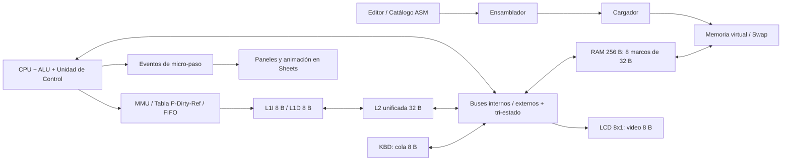

# Arquitectura prevista y decisiones que bloquean implementación

Fuente: parcial2.pdf, secciones 3.1-3.7; rúbrica G1-G7. Este documento es un contrato inicial, no descripción de software terminado.

## Componentes y trazas

## Invariantes obligatorios
- CPU único, programa/proceso/hilo únicos. Datos AX..DX de 8 bits; flags ZF/CF/SF.
- Direcciones virtuales 0..511: VPN = floor(VA/32), offset = VA mod 32. PA = PFN×32 + offset, PFN 0..7. PC y MAR no pueden truncarse a 8 bits; fijar sus anchuras y el formato de IR en la issue de ISA.
- Tabla visible con 16 entradas VPN/P/PFN/Dirty/Reference. RAM estrictamente 256 B. Reservar 8 B de cola KBD y 8 B de video LCD dentro de esos 256 B.
- **FIFO de páginas confirmado.** El mapa de E/S, marcos fijados/no desalojables y páginas utilizables deben acordarse antes del MMU. Las reservas no crean RAM extra y las demos deben provocar fallos usando los marcos realmente disponibles.
- L1I: una línea de 8 B; L1D: una línea de 8 B. **Propuesta para L2:** cuatro líneas de 8 B, reemplazo FIFO. Confirmar políticas de escritura/asignación y direccionamiento físico en el contrato inicial.
- E/S debe ser no cacheable; invalidar líneas de marcos reutilizados y mantener coherencia al cargar o editar memoria. El contrato definirá orden traducción → caché → RAM, evitando datos de una página desalojada.
- Un solo emisor por bus/segmento en cada micro-paso; sin emisor, High-Z; más de uno, error de contención antes de mutar estado. Receptores solo capturan con Load habilitado.
- Bus externo de direcciones de ancho suficiente para PA; bus virtual CPU/MMU suficiente para VA. Separar explícitamente dominio virtual/físico y camino de control/datos.
- La unidad de control produce señales Read/Write/Clock/IO, Enable/Load y micro-palabra visible (incluye En_PC, Ld_MAR, Mem_R, Mem_W, Ld_MDR, En_MDR, Ld_IR, En_ALU, Ld_AX, En_AX, En_KBD y Ld_LCD, extendida a todos los registros).
- Ninguna demo se resuelve con asignaciones directas que omitan buses, cachés o paginación.
- Eventos de micro-paso con ciclo, fase, señales, emisor, receptores, direcciones, bytes y resultado; UI y métricas derivadas del mismo estado confirmado.
- Page Fault pausa/reintenta sin duplicar efectos de instrucción ni consumo de teclado; víctima sucia se conserva en Swap, se transfieren 32 B y se reanuda.

## Contratos a cerrar en las primeras tres tareas
1. Estado serializable, APIs de módulos y formato de eventos/snapshots.
2. ISA, tamaño de instrucciones, anchuras PC/IR/MAR y mapa de memoria/E/S.
3. Políticas de caché/coherencia, micro-palabra y recorrido de los accesos (lectura, escritura, fetch, E/S, Page Fault).

Los tres responsables revisan las decisiones para evitar que Apps Script, memoria y CPU evolucionen de manera incompatible. Persistencia/Step/Run deben respetar límites de Apps Script y no solapar ejecuciones.
