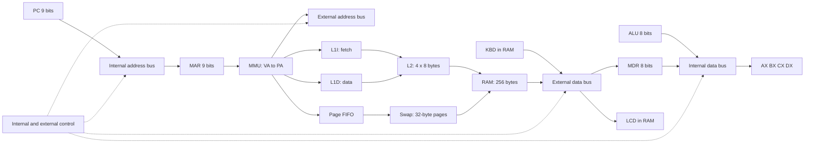

# Architecture, ISA and control

Technical reference for #37 and the integrated coordinator. See #51 for the ISA,
#60 for the cache and control contract, and #69 and #70 for integration. Bilingual
review by another team member remains pending.

## State and memory

AX/BX/CX/DX and MDR are 8-bit; PC/MAR are 9-bit. IR holds four bytes and is
loaded one byte at a time. RAM holds 256 bytes: eight 32-byte frames, seven replaceable.
Virtual space has 512 bytes: 16 pages. VPN 15 is pinned to PFN 7.
KBD occupies PA 224..231 / VA 480..487; LCD occupies PA 232..239 / VA 488..495.
PA 240..255 / VA 496..511 is reserved. LCD starts with eight ASCII 32 spaces.
Keyboard accepts ASCII 32..126, rejects a ninth character and waits when empty.

MMU translates each byte before cache lookup: VPN=floor(VA/32), offset=VA%32,
PA=PFN*32+offset. L1I/L1D each hold one 8-byte line; L2 holds four 8-byte lines.
Physical tags identify floor(PA/8). I/O bypasses caches. FIFO hits do not refresh age.
STORE uses write-through with no allocation on a miss. The micro-step engine
updates L1D and L2 hits and invalidates the affected instruction copy. The
instruction-level adapter keeps the updated L1D hit and invalidates the
L2 copy. Swap saves dirty frames
before reuse. A RAM edit marks the page dirty and invalidates affected lines
before the next fetch.

## Paths

Solid arrows represent routes exercised by the micro-step engine.
Dashed arrows show signals published by the control unit.

## ISA

All instructions occupy four bytes `[opcode,A,B,C]`. AX=0, BX=1,
CX=2, DX=3. `rd`/`rs` are register codes, `imm` is a byte, `lo`/`hi`
encode address `lo+256*hi`, with hi 0 or 1. Unused fields are zero.

| Hex | Instruction | A | B | C | Flags |
|---|---|---|---|---|---|
| 00 | HALT | 0 | 0 | 0 | — |
| 01 | NOP | 0 | 0 | 0 | — |
| 10 | MOV rd, imm | rd | imm | 0 | — |
| 11 | MOV rd, rs | rd | rs | 0 | — |
| 20 | LOAD rd, [addr] | rd | lo | hi | — |
| 21 | STORE [addr], rs | rs | lo | hi | — |
| 30 | ADD rd, rs | rd | rs | 0 | ZF CF SF |
| 31 | SUB rd, rs | rd | rs | 0 | ZF CF SF |
| 32 | INC rd | rd | 0 | 0 | ZF CF SF |
| 33 | DEC rd | rd | 0 | 0 | ZF CF SF |
| 34 | CMP rd, rs | rd | rs | 0 | ZF CF SF |
| 35 | CMP rd, imm | rd | imm | 0 | ZF CF SF |
| 40 | AND rd, rs | rd | rs | 0 | ZF SF; CF=0 |
| 41 | OR rd, rs | rd | rs | 0 | ZF SF; CF=0 |
| 42 | XOR rd, rs | rd | rs | 0 | ZF SF; CF=0 |
| 43 | NOT rd | rd | 0 | 0 | ZF SF; CF preserved |
| 50 | JMP addr | 0 | lo | hi | — |
| 51 | JZ addr | 0 | lo | hi | reads ZF |
| 52 | JNZ addr | 0 | lo | hi | reads ZF |
| 60 | IN rd, [KBD] | rd | 0 | 0 | — |
| 61 | OUT [LCD], rs | rs | 0 | 0 | — |

Data result = raw result AND 255. ZF means zero; SF is bit 7;
CF means carry for ADD/INC and borrow for SUB/DEC/CMP. CMP does not write a register.
Sequential PC advances by four without silent wrapping. Jumps target an actual
instruction boundary in the program; alignment is not required. HALT retains its PC.
STORE to KBD is rejected; LOAD peeks without consuming. STORE to LCD does not move its cursor.

## Signals and control word

`En_X` connects output X to its segment; false leaves that output in High-Z.
`Ld_X` captures the resolved value; false preserves the receiver. X may be
AX/BX/CX/DX, PC, MAR, MDR, IR, ALU, RAM, KBD or LCD according to wiring.
A name in the contract does not authorize arbitrary directions or paths.
IR receives four byte loads, not a 32-bit value over an 8-bit bus.

`Read`/`Write` specify the operation; `IO` selects peripherals;
`Mem_R`/`Mem_W` enable memory; `Clock` confirms the step.
The #60 contract defines 30 bits. Pairs 0–23 are Enable/Load
for AX, BX, CX, DX, PC, IR, MAR, MDR, ALU, RAM, KBD and LCD in that order.
Bits 24–29 are Read, Write, Clock, IO, Mem_R and Mem_W.
In the integrated fetch, PC→MAR activates bits 8, 13 and 26, giving the
derived word 67117312 (0x04002100). See [bit table and validation](MICROWORD.md).
The #69 engine retains those bits and adds Enable/Load pairs for L1I, L1D,
L2, Swap and MMU in bits 30–39. The signal and trace panels show the 40-bit
word and the committed events. The alternate #70 bundle steps one instruction
at a time and keeps the transfer trace.

Real #34 example: PC=300 and MAR=0, En_PC=true and Ld_MAR=true on a 9-bit
virtual bus. The arbiter produces MAR=300, revision 0→1 and a capture with before=0,
after=300. Two drivers reject the transaction; Load without a driver also rejects it.
This is an arbiter trace, not a complete fetch cycle or binary control word.
Reproduce on `feature/cristian/test-cpu-buses`: `node scripts/cpu-bus-trace.cjs`.

## Evidence and remaining work

[Source ISA](../ISA_MAPA_MEMORIA.md), [shared contract](CONTRACTS.md),
[bus PR #52](https://github.com/cristiancarvajal22/arquitectura-parcial2/pull/52),
[ALU PR #53](https://github.com/cristiancarvajal22/arquitectura-parcial2/pull/53),
[keyboard PR #56](https://github.com/cristiancarvajal22/arquitectura-parcial2/pull/56).
External terminology review and a visual micro-step check in the shared
sheet remain pending. The initial #1 fixtures are illustrative. The map described here
comes from #51.
