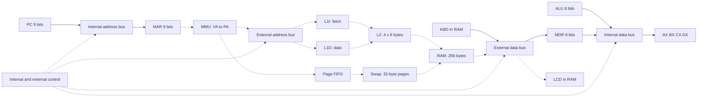

# Architecture, ISA and control

Progress on #37. References: ISA merged in #51, modules in #52–#57 and progress
on #16/#19/#28/#34. These are locally tested modules, not a deployed spreadsheet.
Another member's bilingual review and control encoding in #3 remain pending.

## State and memory

AX/BX/CX/DX and MDR are 8-bit; PC/MAR are 9-bit. IR holds four bytes and is
loaded one byte at a time. RAM holds 256 bytes: eight 32-byte frames, seven replaceable.
Virtual space has 512 bytes: 16 pages. VPN 15 is pinned to PFN 7.
KBD occupies PA 224..231 / VA 480..487; LCD occupies PA 232..239 / VA 488..495.
PA 240..255 / VA 496..511 is reserved. LCD starts with eight ASCII 32 spaces.
Keyboard accepts ASCII 32..126, rejects a ninth character and waits when empty.

MMU translates each byte before cache lookup: VPN=floor(VA/32), offset=VA%32,
PA=PFN*32+offset. L1I/L1D each hold one 8-byte line; L2 holds four 8-byte lines.
Physical tags identify floor(PA/8). I/O bypasses caches. FIFO hits do not refresh age.
Write/allocation policy and writeback remain pending in #3.

## Paths

Solid arrow: path tested in modules. Dashed arrow: intended integration,
not yet demonstrated as a system. Boxes do not imply complete implementation.

## ISA

All instructions occupy four bytes `[opcode,A,B,C]`. AX=0, BX=1,
CX=2, DX=3. `rd`/`rs` are register codes, `imm` is a byte, `lo`/`hi`
encode address `lo+256*hi`, with hi 0 or 1. Unused fields are zero.

| Hex | Instruction | A | B | C | Flags |
|---|---|---|---|---|---|
| 00 | HALT | 0 | 0 | 0 | — |
| 01 | NOP | 0 | 0 | 0 | — |
| 10 | MOV rd, imm | rd | imm | 0 | — |
| 11 | MOV rd, rs | rd | rs | 0 | — |
| 20 | LOAD rd, [addr] | rd | lo | hi | — |
| 21 | STORE [addr], rs | rs | lo | hi | — |
| 30 | ADD rd, rs | rd | rs | 0 | ZF CF SF |
| 31 | SUB rd, rs | rd | rs | 0 | ZF CF SF |
| 32 | INC rd | rd | 0 | 0 | ZF CF SF |
| 33 | DEC rd | rd | 0 | 0 | ZF CF SF |
| 34 | CMP rd, rs | rd | rs | 0 | ZF CF SF |
| 35 | CMP rd, imm | rd | imm | 0 | ZF CF SF |
| 40 | AND rd, rs | rd | rs | 0 | ZF SF; CF=0 |
| 41 | OR rd, rs | rd | rs | 0 | ZF SF; CF=0 |
| 42 | XOR rd, rs | rd | rs | 0 | ZF SF; CF=0 |
| 43 | NOT rd | rd | 0 | 0 | ZF SF; CF preserved |
| 50 | JMP addr | 0 | lo | hi | — |
| 51 | JZ addr | 0 | lo | hi | reads ZF |
| 52 | JNZ addr | 0 | lo | hi | reads ZF |
| 60 | IN rd, [KBD] | rd | 0 | 0 | — |
| 61 | OUT [LCD], rs | rs | 0 | 0 | — |

Data result = raw result AND 255. ZF means zero; SF is bit 7;
CF means carry for ADD/INC and borrow for SUB/DEC/CMP. CMP does not write a register.
Sequential PC advances by four without silent wrapping. Jumps target an actual
instruction boundary in the program; alignment is not required. HALT retains its PC.
STORE to KBD is rejected; LOAD peeks without consuming. STORE to LCD does not move its cursor.

## Signals and control word

`En_X` connects output X to its segment; false leaves that output in High-Z.
`Ld_X` captures the resolved value; false preserves the receiver. X may be
AX/BX/CX/DX, PC, MAR, MDR, IR, ALU, RAM, KBD or LCD according to wiring.
A name in the contract does not authorize arbitrary directions or paths.
IR receives four byte loads, not a 32-bit value over an 8-bit bus.

`Read`/`Write` specify the operation; `IO` selects peripherals;
`Mem_R`/`Mem_W` enable memory; `Clock` confirms the step.
Legal combinations and binary bit assignments belong to #3.
`control.word` and control widths remain null: no bit mapping is approved.
The internal coordinator accepts En/Ld only, generates Clock and rejects memory/I/O operations.

Real #34 example: PC=300 and MAR=0, En_PC=true and Ld_MAR=true on a 9-bit
virtual bus. The arbiter produces MAR=300, revision 0→1 and a capture with before=0,
after=300. Two drivers reject the transaction; Load without a driver also rejects it.
This is an arbiter trace, not a complete fetch cycle or binary control word.
Reproduce on `feature/cristian/test-cpu-buses`: `node scripts/cpu-bus-trace.cjs`.

## Evidence and remaining work

[Source ISA](../ISA_MAPA_MEMORIA.md), [shared contract](CONTRACTS.md),
[bus PR #52](https://github.com/cristiancarvajal22/arquitectura-parcial2/pull/52),
[ALU PR #53](https://github.com/cristiancarvajal22/arquitectura-parcial2/pull/53),
[keyboard PR #56](https://github.com/cristiancarvajal22/arquitectura-parcial2/pull/56).
Pending: external terminology review, control bits #3, complete CPU #5,
memory/cache integration and Sheets demonstration. Initial #1 fixtures are
illustrative: the applicable map is #51's map described here.
