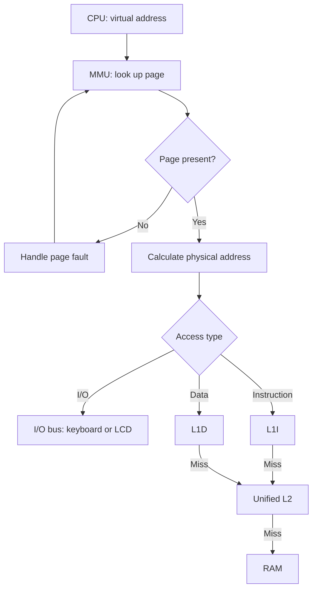

# Caches and control signals — issue #3

Status: proposal pending review with Cristian and Marcelo.

## Data read path

1. The CPU requests a virtual address (VA).
2. The MMU checks its page. If it is not present, the page fault is
   handled before querying any cache.
3. The MMU obtains the physical frame (PFN) and calculates:
   PA = PFN × 32 + (VA % 32).
4. Keyboard and LCD accesses use the I/O bus and bypass all caches.
5. Ordinary data reads query L1D, then L2 on a miss, and finally RAM
   on an L2 miss. RAM supplies an eight-byte cache line.

## Worked example

VA = 100 gives VPN = 3 and offset = 4.
If page 3 occupies PFN = 6, PA = 6 × 32 + 4 = 196.
PA 196 belongs to physical line 192..199: tag = 24, byte offset = 4.
The requested byte is searched in L1D, then L2, then RAM as needed.

## Sizes and identification

L1I stores one eight-byte instruction line.
L1D stores one eight-byte data line.
Unified L2 stores four eight-byte lines: 32 bytes in total.

Each line contains a valid flag, a physical tag and eight bytes.
For physical address PA:

- tag = floor(PA / 8)
- byte offset = PA % 8

An invalid line never produces a hit.
Virtual-to-physical translation precedes every cache lookup.

## Reads and replacement

Instruction fetch queries L1I → L2 → RAM.
Ordinary data reads query L1D → L2 → RAM.

An L2 miss transfers the complete eight-byte physical line through
the bus. The line is installed in L2 and then in the requesting L1.

L2 uses FIFO. When all four entries are occupied, inserting a new line
evicts the earliest inserted line. Hits do not change FIFO order.
The L2 FIFO queue is independent of the MMU page replacement queue.

Each cache counts a hit or miss only when it receives an actual lookup.
An L1 hit does not increase L2 counters.

## Proposed write policy

Write-through and no-write-allocate are proposed:

- Every committed ordinary write updates RAM through the bus.
- Existing copies in L1D and L2 receive the updated byte.
- A write miss does not allocate a new line in that cache.
- A matching L1I line is invalidated to prevent stale instructions.
- Writes set the page Dirty and Reference bits, including on cache hits.
- Reads and instruction fetches also set the page Reference bit.

With write-through, RAM holds the latest committed byte.
Cache lines do not wait for eviction to write their contents to RAM.
A Dirty page still requires saving to Swap before its frame is reused.

## I/O, page replacement and editing

According to the memory map:

| Device | Physical addresses | Virtual addresses |
|---|---|---|
| Keyboard | 224..231 | 480..487 |
| LCD | 232..239 | 488..495 |

Both devices occupy protected physical frame 7.
Their accesses bypass L1I, L1D and L2 and use the I/O bus signals.
Frame 7 is excluded from FIFO page replacement.

Before reusing a physical frame, invalidate every L1I, L1D and L2 line
within its 32-byte physical range.
If the victim page is Dirty, save its 32 RAM bytes to Swap before
overwriting the frame.

Loading another program or editing memory invalidates the affected
physical cache lines, preventing stale data from being returned.

## Proposed buses and control word

Internal and external buses separate address, data and control:

| Segment | Width | Contents |
|---|---:|---|
| internalAddress | 9 bits | Virtual address 0..511 |
| externalAddress | 8 bits | Physical address 0..255 |
| internalData and externalData | 8 bits each | One byte per transfer |
| internalControl and externalControl | 30 bits each | Proposed control signals |

The control unit is the sole driver of control segments.
For a data or address segment:

- Zero active drivers leave the bus in High-Z.
- One active driver transmits a value.
- Two or more active drivers cause BUS_CONTENTION before state changes.

A receiver captures the value only when its Load signal is active.
High-Z does not mean numeric zero.

The proposed fixed bit order starts at bit 0:

En_AX, Ld_AX, En_BX, Ld_BX, En_CX, Ld_CX, En_DX, Ld_DX,
En_PC, Ld_PC, En_IR, Ld_IR, En_MAR, Ld_MAR, En_MDR, Ld_MDR,
En_ALU, Ld_ALU, En_RAM, Ld_RAM, En_KBD, Ld_KBD, En_LCD, Ld_LCD,
Read, Write, Clock, IO, Mem_R, Mem_W.

The numeric control word is the sum of 2^i for every active bit i.
An inactive signal contributes zero to the control word; this does
not mean that its bus carries the value zero.

Read and Write cannot be active together.
Mem_R and Mem_W cannot be active together.
Read may accompany Mem_R during an ordinary RAM read.
IO distinguishes peripheral transactions from ordinary memory accesses.

Cristian and Marcelo must review this bit order and width before
the configuration is marked ready.

## Expected simulator traces

Each arrow represents a transfer committed in its own micro-step.
Two drivers must never drive the same segment simultaneously.

| Operation | Path and relevant signals |
|---|---|
| Fetch | PC → MAR with En_PC/Ld_MAR; translate VA→PA; query L1I→L2→RAM on misses; each received byte passes through MDR→IR with En_MDR/Ld_IR. Read and Clock are active in the corresponding steps. |
| Data read | MAR requests VA; MMU translates; query L1D→L2→RAM as needed; MDR→destination register with En_MDR/Ld_register. A hit avoids lower-level lookups. |
| Write | Register→MDR→RAM through the bus with Write, Clock and Mem_W. Update existing L1D/L2 copies and invalidate a matching L1I line. Set Dirty and Reference upon commit. |
| IN | En_KBD drives the first queued byte toward MDR; MDR→register. IO, Read and Clock identify the I/O operation. Consume the byte exactly once upon commit; wait if the queue is empty. |
| OUT | Register→MDR→LCD with Ld_LCD. IO, Write and Clock identify the I/O operation. Update the RAM video buffer and advance the cursor exactly once upon commit. |
| Page fault | Pause the access; save a Dirty victim's 32 bytes to Swap; invalidate the frame's cache lines; load the new 32-byte page; retry the pending access without duplicating its effects. |

A cache line contains eight bytes, but the data bus carries one byte
per transfer. Filling a line must display all eight transfers.

Animations and counters use committed events.
They must not directly modify RAM or registers.

## Access path diagram

This diagram covers reads and instruction fetches.
A hit returns the byte without querying lower levels.
A RAM access fills L2 and the requesting L1 with the eight-byte line.
Writes follow the write-through and no-write-allocate policy above.
I/O bypasses the caches.