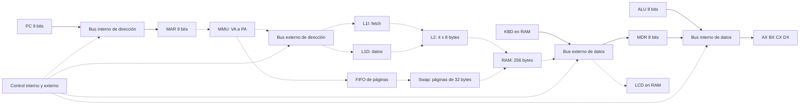

# Arquitectura, ISA y control

Avance de #37. Referencia: ISA integrada en #51, módulos de #52–#57 y avances
de #16/#19/#28/#34. Son módulos probados localmente; no una planilla desplegada.
La revisión bilingüe por otro integrante y la codificación de control #3 siguen pendientes.

## Estado y memoria

AX/BX/CX/DX y MDR tienen 8 bits; PC/MAR, 9 bits. IR contiene cuatro bytes y se
carga byte a byte. RAM contiene 256 bytes: ocho marcos de 32, siete reemplazables.
El espacio virtual tiene 512 bytes: 16 páginas. VPN 15 está fijada a PFN 7.
KBD ocupa PA 224..231 / VA 480..487; LCD, PA 232..239 / VA 488..495.
PA 240..255 / VA 496..511 está reservado. LCD inicia con ocho espacios ASCII 32.
Teclado acepta ASCII 32..126, rechaza noveno carácter y espera si está vacío.

MMU traduce cada byte antes de consultar caché: VPN=floor(VA/32), offset=VA%32,
PA=PFN*32+offset. L1I/L1D tienen una línea de 8 bytes; L2, cuatro líneas de 8.
Tags físicos identifican floor(PA/8). E/S evita cachés. FIFO no rejuvenece por hit.
La política de escritura/asignación y el writeback siguen pendientes de #3.

## Recorridos

Flecha continua: recorrido probado en módulos. Flecha discontinua: integración
prevista, todavía no demostrada como sistema. Las cajas no afirman implementación completa.

## ISA

Todas las instrucciones ocupan cuatro bytes `[opcode,A,B,C]`. AX=0, BX=1,
CX=2, DX=3. `rd`/`rs` son códigos de registro, `imm` es byte, `lo`/`hi`
codifican dirección `lo+256*hi`, con hi 0 o 1. Campos no usados valen cero.

| Hex | Instrucción | A | B | C | Flags |
|---|---|---|---|---|---|
| 00 | HALT | 0 | 0 | 0 | — |
| 01 | NOP | 0 | 0 | 0 | — |
| 10 | MOV rd, imm | rd | imm | 0 | — |
| 11 | MOV rd, rs | rd | rs | 0 | — |
| 20 | LOAD rd, [addr] | rd | lo | hi | — |
| 21 | STORE [addr], rs | rs | lo | hi | — |
| 30 | ADD rd, rs | rd | rs | 0 | ZF CF SF |
| 31 | SUB rd, rs | rd | rs | 0 | ZF CF SF |
| 32 | INC rd | rd | 0 | 0 | ZF CF SF |
| 33 | DEC rd | rd | 0 | 0 | ZF CF SF |
| 34 | CMP rd, rs | rd | rs | 0 | ZF CF SF |
| 35 | CMP rd, imm | rd | imm | 0 | ZF CF SF |
| 40 | AND rd, rs | rd | rs | 0 | ZF SF; CF=0 |
| 41 | OR rd, rs | rd | rs | 0 | ZF SF; CF=0 |
| 42 | XOR rd, rs | rd | rs | 0 | ZF SF; CF=0 |
| 43 | NOT rd | rd | 0 | 0 | ZF SF; CF intacto |
| 50 | JMP addr | 0 | lo | hi | — |
| 51 | JZ addr | 0 | lo | hi | consulta ZF |
| 52 | JNZ addr | 0 | lo | hi | consulta ZF |
| 60 | IN rd, [KBD] | rd | 0 | 0 | — |
| 61 | OUT [LCD], rs | rs | 0 | 0 | — |

Resultado de datos = resultado bruto AND 255. ZF indica cero; SF, bit 7;
CF indica carry en ADD/INC y préstamo en SUB/DEC/CMP. CMP no escribe registro.
PC secuencial avanza cuatro sin wrap silencioso. Saltos apuntan a una frontera
de instrucción del programa; no se exige alineación. HALT conserva su PC.
STORE sobre KBD se rechaza; LOAD lo inspecciona sin consumir. STORE LCD no mueve cursor.

## Señales y micro-palabra

`En_X` conecta la salida X al segmento; false deja esa salida en High-Z.
`Ld_X` captura el valor resuelto; false conserva el receptor. X puede ser
AX/BX/CX/DX, PC, MAR, MDR, IR, ALU, RAM, KBD o LCD según el cableado.
Un nombre en el contrato no autoriza cualquier sentido ni cualquier recorrido.
IR recibe cuatro cargas de byte, no un dato de 32 bits por bus de 8 bits.

`Read`/`Write` indican la operación; `IO`, selección de periféricos;
`Mem_R`/`Mem_W`, habilitación de memoria; `Clock`, confirmación del paso.
Sus combinaciones legales y asignación de posiciones binarias corresponden a #3.
`control.word` y anchuras de control siguen null: no hay un mapa de bits aprobado.
El coordinador interno solo acepta En/Ld, genera Clock y rechaza operaciones de memoria/E/S.

Ejemplo real de #34: PC=300 y MAR=0, En_PC=true y Ld_MAR=true sobre bus virtual
de 9 bits. El árbitro produce MAR=300, revisión 0→1 y una captura con before=0,
after=300. Con dos emisores rechaza todo; con Load sin emisor también rechaza.
La traza es del árbitro, no de un ciclo fetch completo ni de una palabra binaria.
Reproducción en rama `feature/cristian/test-cpu-buses`: `node scripts/cpu-bus-trace.cjs`.

## Evidencias y pendientes

[ISA fuente](../ISA_MAPA_MEMORIA.md), [contrato compartido](CONTRATOS.md),
[PR buses #52](https://github.com/cristiancarvajal22/arquitectura-parcial2/pull/52),
[PR ALU #53](https://github.com/cristiancarvajal22/arquitectura-parcial2/pull/53),
[PR teclado #56](https://github.com/cristiancarvajal22/arquitectura-parcial2/pull/56).
Pendiente: revisión terminológica externa, bits de control #3, CPU completa #5,
conexión de memoria/cachés y demostración en Sheets. Las fixtures iniciales de #1
son ilustrativas: el mapa aplicable es el de #51 descrito aquí.
