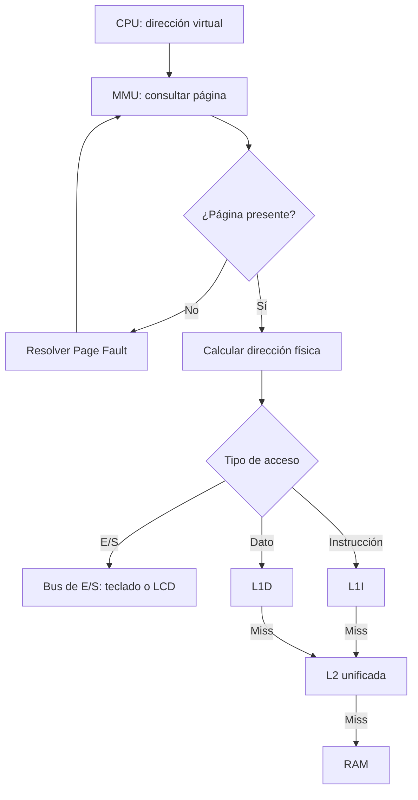

# Cachés y señales de control — tarea #3

Estado: propuesta para revisión con Cristian y Marcelo.

## Recorrido de una lectura de datos

1. La CPU solicita una dirección virtual (VA).
2. La MMU busca su página. Si no está presente, se atiende el Page Fault antes de consultar la caché.
3. Si está presente, la MMU obtiene el marco físico (PFN) y calcula la dirección física: PA = PFN × 32 + (VA % 32).
4. Si la dirección corresponde a teclado o LCD, se accede al dispositivo por el bus sin consultar L1D ni L2.
5. Para datos ordinarios, se consulta L1D. Si hay miss, se consulta L2. Si también hay miss, se obtiene de RAM una línea de 8 bytes.

## Ejemplo comprobable

VA = 100 → VPN = 3 y desplazamiento = 4.
Si la página 3 está en PFN = 6, entonces PA = 6 × 32 + 4 = 196.
PA 196 pertenece a la línea física 192..199: tag = 24 y posición dentro de la línea = 4.
Una lectura de datos busca ese byte primero en L1D, después en L2 y finalmente en RAM si hace falta.

## Tamaños e identificación

L1I guarda una línea de 8 bytes para instrucciones. L1D guarda una línea de
8 bytes para datos. L2 es unificada: cuatro líneas de 8 bytes, 32 bytes en total.

Cada línea tiene válido, tag físico y ocho bytes. Para una dirección física PA:
tag = floor(PA / 8) y posición = PA % 8. Una línea inválida nunca produce hit.
La traducción virtual → física ocurre antes de consultar cualquier caché.

## Lecturas y reemplazo

Fetch consulta L1I → L2 → RAM. Una lectura ordinaria consulta L1D → L2 → RAM.
En un miss de L2 se trae por el bus la línea física completa de ocho bytes.
Se carga primero en L2 y luego en la L1 solicitante.

L2 usa FIFO: al insertar una línea nueva en sus cuatro posiciones ocupadas,
sale la que ingresó primero. Un hit no cambia el orden FIFO. La cola FIFO de L2
es independiente de la cola FIFO de páginas de la MMU.

Cada caché cuenta un hit o miss solo cuando recibe una consulta real. L2 no
aumenta sus contadores cuando L1 responde con hit.

## Escrituras: política propuesta para revisar con el equipo

Se propone write-through y no-write-allocate:

- Toda escritura ordinaria confirmada actualiza RAM a través del bus.
- Si la línea existe en L1D o L2, se actualiza también el byte de esa copia.
- Si falta en una caché, la escritura no carga allí una línea nueva.
- Si L1I contiene esa dirección física, se invalida para evitar ejecutar
  instrucciones antiguas después de modificar memoria.
- La página se marca Dirty y Reference aunque la operación haya encontrado
  el dato en caché. Una lectura o fetch también marca Reference.

Con write-through, RAM contiene la versión más reciente de un byte confirmado;
las líneas de caché no necesitan esperar a un desalojo para escribirlo en RAM.
Una página Dirty todavía debe guardarse en Swap antes de abandonar su marco.

## E/S, cambio de página y edición

Según el mapa de memoria, KBD ocupa PA 224..231 y LCD PA 232..239, dentro
del marco físico 7 protegido. Sus direcciones virtuales son 480..487 y
488..495. Estos accesos evitan L1I, L1D y L2; usan el recorrido de E/S y
las señales del bus. El marco 7 no participa en FIFO de páginas.

Antes de reutilizar un marco físico, se invalidan en L1I, L1D y L2 todas
las líneas cuya dirección física pertenezca a sus 32 bytes. Si la víctima
está Dirty, se guardan sus 32 bytes de RAM en Swap antes de reemplazarla.
Al cargar otro programa o editar memoria se invalidan las líneas físicas
afectadas. Así ninguna caché entrega bytes de una página anterior.

## Buses y micro-palabra propuesta

Los buses internos y externos separan dirección, datos y control:

| Segmento | Ancho | Contenido |
|---|---:|---|
| internalAddress | 9 bits | Dirección virtual 0..511 |
| externalAddress | 8 bits | Dirección física 0..255 |
| internalData y externalData | 8 bits cada uno | Un byte por transferencia |
| internalControl y externalControl | 30 bits cada uno | Señales de control propuestas |

La unidad de control es la única emisora de los segmentos de control. En un
segmento de datos o direcciones, ningún emisor deja el bus en Z; uno transmite;
dos o más provocan BUS_CONTENTION antes de cambiar el estado. Solo un receptor
con su señal Load activa captura el valor. Z no representa el número cero.

Se propone este orden fijo de bits, comenzando por el bit 0:

En_AX, Ld_AX, En_BX, Ld_BX, En_CX, Ld_CX, En_DX, Ld_DX,
En_PC, Ld_PC, En_IR, Ld_IR, En_MAR, Ld_MAR, En_MDR, Ld_MDR,
En_ALU, Ld_ALU, En_RAM, Ld_RAM, En_KBD, Ld_KBD, En_LCD, Ld_LCD,
Read, Write, Clock, IO, Mem_R, Mem_W.

La micro-palabra numérica es la suma de 2^i por cada bit activo i. Una señal
apagada vale 0 en la micro-palabra; eso no significa que el bus transporte 0.
Read y Write no se activan juntos; Mem_R y Mem_W tampoco. Read puede
acompañar a Mem_R durante una lectura ordinaria de RAM. IO distingue una
transacción de periférico de una de memoria ordinaria. Este orden y ancho
deben aprobarse con Cristian y Marcelo antes de usar un perfil `ready`.

## Trazas que debe producir el simulador

Cada flecha representa una transferencia confirmada en su propio micro-paso;
no se habilitan simultáneamente dos emisores sobre el mismo segmento.

| Operación | Recorrido y señales relevantes |
|---|---|
| Fetch | PC → MAR con En_PC/Ld_MAR; traducción VA→PA; L1I→L2→RAM si hay misses; cada byte recibido pasa por MDR→IR con En_MDR/Ld_IR. Read y Clock activos en los pasos correspondientes. |
| Lectura de datos | MAR solicita VA; MMU traduce; L1D→L2→RAM si hace falta; MDR→registro destino mediante En_MDR/Ld_registro. Un hit evita consultar niveles inferiores. |
| Escritura | Registro→MDR→RAM por bus con Write, Clock y Mem_W; se actualizan las copias presentes en L1D/L2 y se invalida la coincidencia en L1I. Dirty y Reference se marcan al confirmar. |
| IN | En_KBD transmite el primer byte de la cola por el bus hacia MDR; MDR→registro. IO, Read y Clock indican E/S. Se consume exactamente una vez al confirmar; si la cola está vacía se espera. |
| OUT | Registro→MDR→LCD mediante Ld_LCD; IO, Write y Clock indican E/S. El byte se escribe en el video real de RAM y el cursor avanza una sola vez al confirmar. |
| Page Fault | Se pausa el acceso; si la víctima está Dirty se guardan sus 32 bytes en Swap; se invalidan las líneas del marco; se carga la nueva página de 32 bytes y se reintenta el acceso pendiente sin duplicar sus efectos. |

Una línea de caché contiene ocho bytes, pero el bus de datos transporta
un byte por transferencia: su llenado debe mostrar los ocho movimientos.
Las animaciones y contadores usan los eventos confirmados, no cambian
directamente RAM ni registros.

## Diagrama del recorrido

El diagrama muestra lecturas y búsqueda de instrucciones. Un hit devuelve
el byte sin consultar niveles inferiores. Si se llega a RAM, se carga
la línea de ocho bytes en L2 y en la L1 solicitante.
Las escrituras siguen la política write-through y no-write-allocate
descrita arriba. La E/S no consulta las cachés.