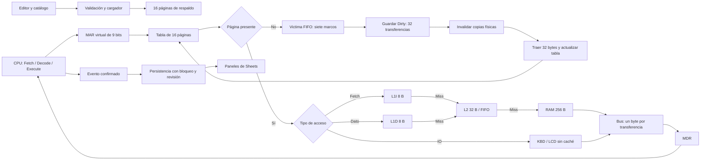

# Integración de las tareas de Marcelo

El coordinador está en `src/core/machine.js`. Consume los módulos de CPU/ALU, buses, RAM, FIFO, teclado, ensamblador, L1I, L2 y Swap del equipo; sus commits originales se preservan como ancestros de esta rama.

## Recorrido

## Atomicidad y esperas

`step` devuelve `completed`, `pending` o `rejected`. El candidato se construye sobre una copia. El árbitro valida todos los segmentos de datos/dirección antes de capturar; un rechazo no publica ni reloj, ni contadores, ni bytes parciales del micro-paso. Cada evento confirmado avanza una revisión y un ciclo.

La petición de memoria conserva requestId, etapa, índices de transferencia y contabilidad de búsquedas. Page Fault se atiende antes de consultar cachés. Por ello, esperar no repite misses. Una espera de teclado vacío no cambia estado ni consume un byte. La última confirmación de STEP puede reproducirse sin repetir efectos; la capa de reloj también conserva su recibo por época/secuencia.

La ALU de datos sigue siendo de ocho bits. El camino de direcciones utiliza una salida combinacional de nueve bits para PC/MAR. INC y DEC seleccionan la constante interna uno como entrada de ALU; no simulan una lectura oculta de memoria.

## Micropalabra

La integración conserva los bits 0..29 de `microWordSignals`. Añade, en orden, En_L1I, Ld_L1I, En_L1D, Ld_L1D, En_L2, Ld_L2, En_SWAP, Ld_SWAP, En_MMU y Ld_MMU. Los buses de control son de 40 bits y se calculan sumando potencias de dos, sin operadores bit a bit de JavaScript de 32 bits. Los buses de datos conservan ocho bits.

Esta extensión hace visibles los buffers de caché, Swap y traducción. Debe revisarse junto con el contrato #3; la función antigua `microWordView`, limitada al perfil de 30 bits, no se usa para renderizar la nueva palabra.

## Estado y pruebas

El único estado activo está en el almacén de propiedades con dos slots de Joseph y bloqueo global. La UI se deriva de ese estado después de guardarlo. Reset elimina programa y métricas y cambia de época; no restaura un programa de forma oculta.

La prueba completa de memoria escribe 32 valores diferentes en una página, fuerza reemplazos, recarga y compara los 32 bytes. Las tres demos y sus trazas se generan con `node scripts/demo-evidence.cjs`.

La prueba de Sheets usa dobles de sus servicios: comprueba las escrituras de paneles y persistencia, pero no sustituye ejecutar el paquete en Google Sheets. La instalación y la validación por otro integrante siguen siendo comprobaciones humanas.
